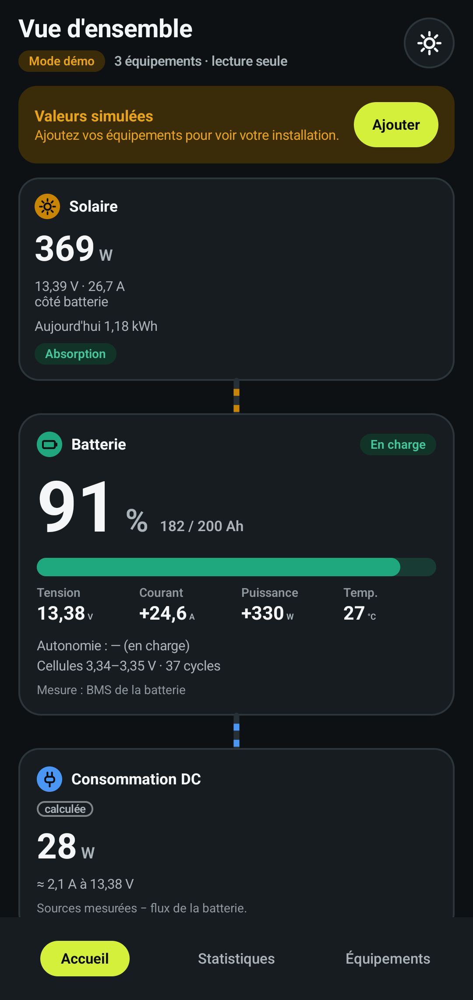
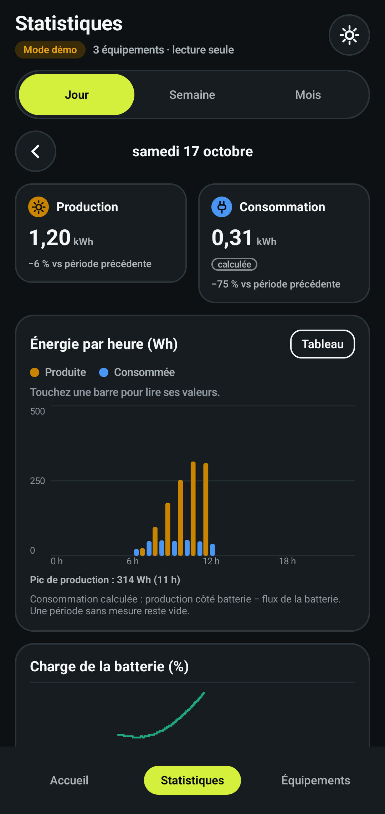
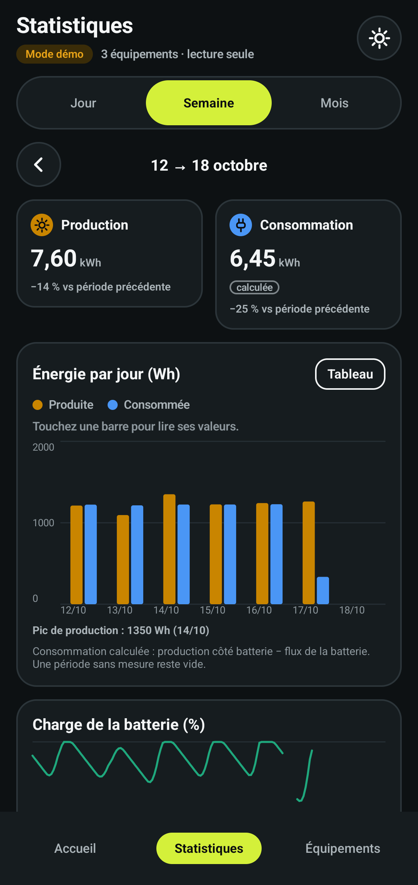
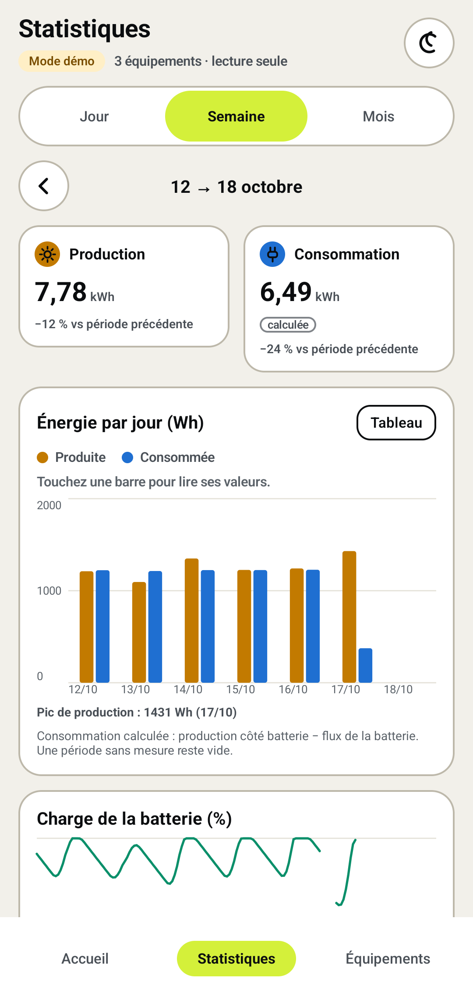

# Voltdeck

Tableau de bord mobile (Android et iOS), **en lecture seule**, qui réunit en un seul endroit les mesures Bluetooth des équipements d'un système électrique 12/24 V : batteries lithium à BMS (Ultimatron…), régulateurs solaires MPPT, chargeurs DC-DC, shunts (Victron SmartSolar, Orion, SmartShunt…).

- Une seule app au lieu d'une app par marque.
- Historique et statistiques poussées par équipement et pour le système entier.
- Aucun réglage modifié : l'app lit, elle n'écrit jamais.
- Pilotes d'équipements enfichables pour ajouter d'autres marques.

<p>
  
  
  
  
</p>

Captures du mode démo : valeurs simulées, avec 60 jours d'historique générés au lancement.

> État : socle technique (Kotlin Multiplatform, contrats BLE, simulateur, mode démo) et premier pilote : Victron Instant Readout (SmartSolar MPPT, SmartShunt / BMV, Orion Smart DC-DC), validé sur des vecteurs de référence et sur le simulateur, pas encore sur du matériel réel.

## Lecture seule, garantie par quatre verrous

1. **Frontière de module** : seul `ble/.../KableTransport.kt` appelle une écriture BLE. Les pilotes (`drivers/`) n'ont accès qu'à `ReadOnlyGattLink`, qui n'expose ni `write` ni `writeWithoutResponse`.
2. **Liste blanche** : `ReadOnlyGattLink.request()` n'accepte qu'une `AllowedCommand` (`ble/.../ReadAllowlist.kt`), un nombre fermé de trames de lecture documentées (JBD : `DD A5 03|04|05 00 FF xx 77`). Toute autre trame (`DD 5A …` écriture, `FF AA …` authentification) lève `ForbiddenCommandException` avant d'atteindre la radio.
3. **Contrôle CI** : le build échoue si `.write(` ou `writeWithoutResponse` apparaît hors de `KableTransport.kt` (`scripts/ci/check-readonly.sh`).
4. **Aucune permission `INTERNET`** : un test sur le manifest fusionné fait échouer le build si elle apparaît. Aucune donnée ne quitte le téléphone.

Les équipements Victron ne sont jamais connectés : leurs mesures se lisent par écoute passive des annonces Bluetooth (Instant Readout).

## Organisation

| Module | Rôle |
|---|---|
| `core/` | Modèle commun : `DeviceId`, `DeviceRole`, `Metric`, `Sample`, `Reading` (courant > 0 = la batterie se charge) |
| `ble/` | Contrats `BleTransport` / `ReadOnlyGattLink`, liste blanche, `KableTransport` (Kable 0.45) |
| `drivers/` | Pilotes d'équipements : `victron.ir` (Victron Instant Readout, écoute passive des annonces chiffrées) |
| `simulator/` | `SimulatedTransport` déterministe (horloge injectée, graine fixe) : une batterie, un MPPT et un SmartShunt, avec de vraies annonces Victron chiffrées ; scénarios `sunny_day` et `wrong_victron_key` |
| `storage/` | Stockage local SQLDelight : agrégats minute / heure / jour / mois, roll-up idempotent, rétention des minutes (30 jours), `SystemStats` (production, consommation, autonomie, cycles). Mode démo dans un fichier séparé (`voltdeck-demo.db`) |
| `composeApp/` | Application Compose Multiplatform (Android + iOS), écran « Mode démo » |
| `iosApp/` | Coque Xcode iOS |
| `scripts/ci/` | Contrôles de la CI (lecture seule, anti-secret, auto-test des contrôles) |

## Construire

Prérequis : JDK 21, Android SDK (plateforme 36). Pour iOS : un Mac avec Xcode.

```sh
./gradlew check                       # tests unitaires, lint, contrôle du manifest
./gradlew :composeApp:assembleDebug   # APK : composeApp/build/outputs/apk/debug/composeApp-debug.apk
scripts/ci/selftest.sh                # vérifie que les contrôles de la CI échouent quand ils le doivent
```

iOS (sur Mac) : `./gradlew iosSimulatorArm64Test`, puis ouvrir `iosApp/iosApp.xcodeproj` dans Xcode. La coque Xcode n'a pas encore été ouverte sur un Mac.

## Victron Instant Readout

Le pilote `victron.ir` décode les annonces Bluetooth chiffrées (Company ID `0x02E1`, premier octet `0x10`) du SmartSolar MPPT (`0x01`), du SmartShunt / BMV (`0x02`) et de l'Orion Smart DC-DC (`0x04`). Il ne se connecte jamais à l'appareil. Format : PDF Victron « Extra manufacturer Data » (2022-12-14), voir l'en-tête de chaque fichier de `drivers/.../victron/`.

- **Clé** : 32 caractères hexadécimaux, propre à chaque appareil (VictronConnect, Infos produit, Lecture instantanée via Bluetooth). Saisie masquée, octet de contrôle comparé à une annonce reçue avant tout enregistrement. Stockée dans le Keystore Android (AES-GCM non exportable) ou le Keychain iOS, jamais en SQLite ni dans un journal. Limite : l'octet de contrôle ne protège que 1 fois sur 256 d'une mauvaise clé.
- **Valeurs absentes** : un champ « non disponible » (NA) ne produit aucune mesure, jamais un 0.
- **Annonce plus longue que prévu** : décodée sans erreur. **Trame tronquée** : ignorée et comptée (`VictronDiagnostics.truncatedFrames`).

## Mode démo

Au lancement, l'app affiche le **Mode démo** : les `Reading` d'une batterie LiFePO4 200 Ah (directement du modèle), d'un régulateur MPPT et d'un SmartShunt simulés (annonces Victron chiffrées, déchiffrées par le pilote avec la clé de test publique, TEST ONLY), mis à jour en direct, sans Bluetooth ni permission. Le scénario `wrong_victron_key` fait annoncer les appareils avec une autre clé : le pilote refuse de les décoder jusqu'à la saisie de la bonne clé, affichée à l'écran. Le temps simulé s'écoule 60 fois plus vite que le temps réel (une journée en 24 minutes) pour voir le soleil se lever, un nuage passer et la batterie se charger. Le simulateur est déterministe : même graine, mêmes valeurs.

## Licence

Apache-2.0, voir [LICENSE](LICENSE) et [NOTICE](NOTICE).
