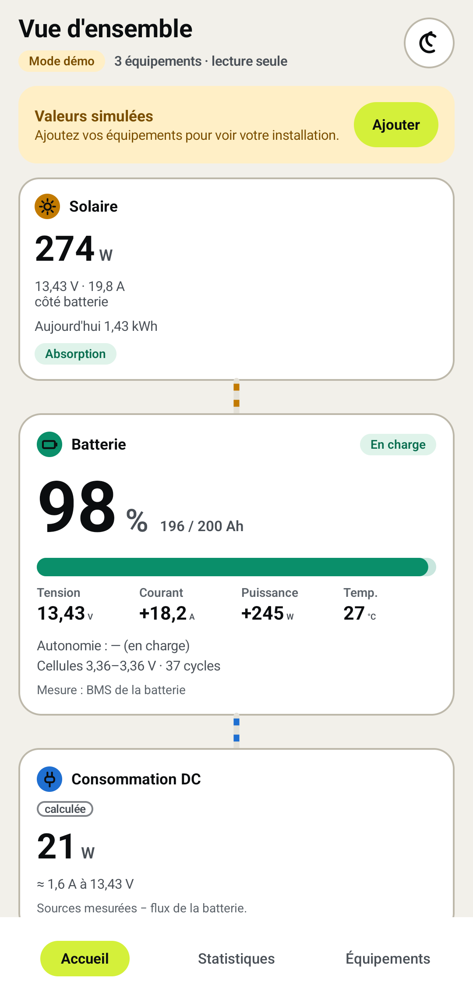

# Voltdeck

Tableau de bord mobile **en lecture seule** pour les systèmes électriques 12/24 V de vans, bateaux et sites isolés. Il réunit dans une seule app les mesures Bluetooth des batteries lithium à BMS, des régulateurs solaires MPPT, des chargeurs DC-DC et des shunts, quelle que soit leur marque.

<p>
  
  
  
  
</p>

<sub>Captures du mode démo : valeurs simulées, avec 60 jours d'historique générés au lancement.</sub>

## Pourquoi

Une installation typique mélange une batterie Ultimatron, un MPPT et un shunt Victron, parfois un DC-DC : autant d'apps, chacune avec sa vue partielle, et aucune qui réponde à la question qu'on se pose vraiment : *combien j'ai produit, combien j'ai consommé, et combien de temps je tiens encore ?*

Voltdeck lit tous ces équipements, les combine en une vue du système, garde l'historique sur le téléphone et n'envoie jamais aucun ordre aux appareils.

## Ce que fait l'app

- **Vue d'ensemble façon tableau de bord GX** : production solaire, batterie (charge, tension, courant, cellules, température), consommation DC calculée, autonomie estimée.
- **Statistiques** jour, semaine et mois : énergie produite et consommée par heure ou par jour, courbe de charge de la batterie, minimums et maximums, comparaison avec la période précédente, vue tableau accessible.
- **Collecte écran éteint** sur Android (service au premier plan, notification avec bouton d'arrêt) pour ne pas avoir de trou dans l'historique.
- **Position du shunt** : sur la batterie, sur une charge ou sur une source. Détectée quand l'appareil l'annonce, réglable sinon, pour que le calcul de consommation reste juste.
- **Diagnostic partageable** : état de la collecte, du Bluetooth et de chaque équipement, sans aucune adresse ni clé.
- **Mode démo** complet, sans Bluetooth ni permission, pour découvrir l'app avant d'avoir branché quoi que ce soit.
- Thèmes clair et sombre, interface en français.

## Équipements pris en charge

| Pilote | Équipements | Lecture | État |
|---|---|---|---|
| `victron.ir` | SmartSolar MPPT, SmartShunt / BMV, Orion Smart DC-DC, compteur d'énergie DC | Écoute passive des annonces chiffrées (Instant Readout), aucune connexion | Validé sur les vecteurs de référence publics et le simulateur |
| `jbd.gatt` | Batteries à BMS JBD (Ultimatron et autres marques) | Connexion GATT, trames de lecture seulement | Validé sur le simulateur |

Aucun des deux pilotes n'a encore été validé sur du matériel réel. Les pilotes sont enfichables : ajouter une marque revient à écrire un `DeviceDriver` (`drivers/`).

## Lecture seule, garantie par quatre verrous

1. **Frontière de module** : seul `ble/.../KableTransport.kt` appelle une écriture BLE. Les pilotes (`drivers/`) n'ont accès qu'à `ReadOnlyGattLink`, qui n'expose ni `write` ni `writeWithoutResponse`.
2. **Liste blanche** : `ReadOnlyGattLink.request()` n'accepte qu'une `AllowedCommand` (`ble/.../ReadAllowlist.kt`), un nombre fermé de trames de lecture documentées (JBD : `DD A5 03|04|05 00 FF xx 77`). Toute autre trame (`DD 5A …` écriture, `FF AA …` authentification) lève `ForbiddenCommandException` avant d'atteindre la radio.
3. **Contrôle CI** : le build échoue si `.write(` ou `writeWithoutResponse` apparaît hors de `KableTransport.kt` (`scripts/ci/check-readonly.sh`).
4. **Aucune permission `INTERNET`** : le build échoue si elle apparaît dans le manifest fusionné. Aucune donnée ne quitte le téléphone.

## Clés Victron

Les annonces Victron sont chiffrées avec une clé propre à chaque appareil (VictronConnect, Infos produit, Lecture instantanée via Bluetooth).

- Saisie masquée, vérifiée avant tout enregistrement : octet de contrôle, puis déchiffrement d'essai de plusieurs annonces distinctes avec contrôle de vraisemblance des valeurs, pour refuser une coquille.
- Stockée dans le Keystore Android (AES-GCM non exportable) ou le Keychain iOS, jamais en base ni dans un journal.
- Un champ « non disponible » ne produit aucune mesure, jamais un 0. Une trame tronquée est ignorée et comptée dans le diagnostic.

## Historique et statistiques

Stockage local SQLDelight : agrégats à la minute (30 jours), à l'heure, au jour et au mois, avec consolidation idempotente. L'énergie est intégrée à pleine résolution (Wh et Ah entrants et sortants). La consommation est **calculée** (production côté batterie moins flux de la batterie) et marquée comme telle ; une période sans mesure reste vide, jamais à zéro.

## Organisation

| Module | Rôle |
|---|---|
| `core/` | Modèle commun : `DeviceId`, `DeviceRole`, `Metric`, `Sample`, `Reading` (courant > 0 = la batterie se charge) |
| `ble/` | Contrats `BleTransport` / `ReadOnlyGattLink`, liste blanche, `KableTransport` (Kable) |
| `drivers/` | Pilotes d'équipements : `victron.ir`, `jbd.gatt` |
| `simulator/` | Installation simulée déterministe (batterie, MPPT, SmartShunt) qui émet de vraies annonces Victron chiffrées et de vraies trames JBD |
| `storage/` | Agrégats, rétention, statistiques système (production, consommation, autonomie, cycles) |
| `composeApp/` | Application Compose Multiplatform (Android, iOS) |
| `iosApp/` | Coque Xcode iOS |
| `scripts/ci/` | Contrôles de la CI (lecture seule, anti-secret, auto-test des contrôles) |

## Construire

Prérequis : JDK 21, Android SDK (plateforme 36). Pour iOS : un Mac avec Xcode.

```sh
./gradlew check                       # tests unitaires, lint, contrôle du manifest
./gradlew :composeApp:assembleDebug   # APK : composeApp/build/outputs/apk/debug/composeApp-debug.apk
scripts/ci/selftest.sh                # vérifie que les contrôles de la CI échouent quand ils le doivent
```

Aucune version n'est encore publiée sur un store. iOS compile mais n'a pas encore été essayé sur un appareil.

## Mode démo

Sans équipement enregistré, l'app s'ouvre en mode démo : une batterie LiFePO4 200 Ah, un MPPT et un SmartShunt simulés, dont les annonces Victron chiffrées passent par le vrai pilote avec une clé de test publique (TEST ONLY). Le temps simulé s'écoule 60 fois plus vite (une journée en 24 minutes) et la base démarre avec 60 jours d'historique à l'ensoleillement variable. Le scénario `wrong_victron_key` montre le refus d'une mauvaise clé. Le simulateur est déterministe : même graine, mêmes valeurs.

## Licence

Apache-2.0, voir [LICENSE](LICENSE) et [NOTICE](NOTICE). Victron, Ultimatron et Jiabaida sont des marques de leurs propriétaires respectifs ; Voltdeck n'est affilié à aucun d'eux.
